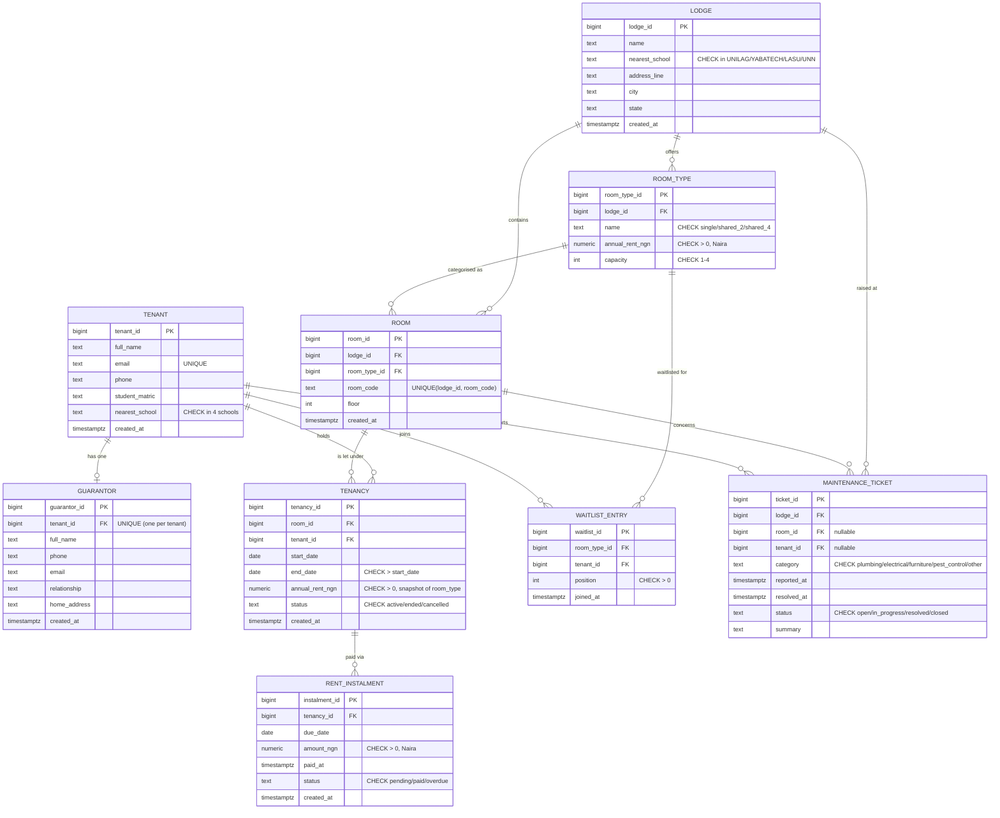

# Portfolio 1 - Database Design and Modelling

**Student:** Amaka Benedicta Chukwudebe
**Matric:** 2026/A/MIT/0517
**Programme:** Master of Information Technology
**Institution:** Miva Open University
**Course:** MIT 8103 - Advanced Database Systems
**Academic session:** 2026/2027 First Semester (September Cohort 2026)
**Case study:** CampusNest - Private Student Accommodation Booking

---

## Study session covered

**Study Session 1 - Review of Traditional Relational Databases and Advanced
Concepts.** This portfolio demonstrates the normalisation, database design,
and advanced-constraint topics of that session: entity-relationship modelling,
third normal form, exclusion constraints (btree_gist), CHECK and UNIQUE
constraints, and deferred constraint triggers.

---

## What this portfolio demonstrates (plain English)

CampusNest is a simulated company that books private student lodges near four
Nigerian tertiary institutions (UNILAG, YABATECH, LASU, UNN). This portfolio
designs the relational database that stores CampusNest's data.

It contains:

1. **A 9-table relational schema** (`schema.sql`) covering lodges, room
   types, rooms, tenants, guarantors, tenancies, rent instalments, a waitlist,
   and maintenance tickets.
2. **Two advanced exclusion constraints** that use the `btree_gist` extension
   to prevent two tenants from being booked into the same room at the same
   time, and to prevent one tenant from holding two overlapping tenancies on
   different rooms.
3. **Two trigger functions** that enforce business rules a plain CHECK
   cannot: rent instalments for one tenancy must not sum above the annual
   rent, and every tenant must have at least one guarantor (a deferred
   constraint trigger so tenant + guarantor can be inserted in one
   transaction in any order).
4. **A Mermaid ER diagram** (`er_diagram.mmd`) showing all nine entities,
   their attributes with PK / FK markers, and the relationships between them.
5. **A 3NF analysis** (`notes_3nf.md`) explaining in plain English what 1NF,
   2NF, and 3NF mean, and walking through each of the nine tables to show it
   is in third normal form.
6. **A small realistic seed** (`seed.sql`) with four lodges near the four
   schools, twelve room types, twenty-four rooms, twelve tenants and
   guarantors, eight tenancies, eighteen instalments, two waitlist entries,
   and four maintenance tickets - all in Naira and all satisfying every
   constraint.
7. **A bulk generator** (`bulk_generator.py`) that loads 60,000 tenants with
   guarantors, 20,000 additional rooms, 60,000 non-overlapping tenancies
   spanning three academic years, and ~150,000 rent instalments that each sum
   to exactly the annual rent - by construction, never by catching errors.
8. **Seven negative tests** (`constraint_tests.sql`) that each deliberately
   violate one constraint and are expected to fail - the failure is the proof
   the constraint works.

---

## A `room` row is one lettable bed-space

CampusNest lets **bed-spaces**, not whole rooms. A single room is one row in
`room`; a `shared_4` room appears as four rows (`...-B1` to `...-B4`), and
`room_type.capacity` says how many students share that physical room. This is
why the exclusion constraint on `tenancy (room_id, daterange)` is correct for
shared rooms too: each student holds their own bed for the session.

## ER diagram (renders on GitHub)



## Data generated by `bulk_generator.py`

100 lodges (4 seed + 24 more near each school), about 15,000 bed-spaces,
five academic sessions (three finished, the current one, and early bookings
for next session), 50,000+ tenancies with varying occupancy, about 3%
cancelled bookings, returning students, gender-matched Nigerian names,
120,000+ rent instalments that add up exactly to each tenancy's rent, and
waitlists plus maintenance tickets. All dates are computed from today.

## Exact Codespaces commands to run it (in order)

Run these in a Codespace terminal, from the repository root.

```bash
# One-time: install PostgreSQL 16 + MongoDB 8 + create the campusnest db.
chmod +x setup.sh
./setup.sh

# Portfolio 1: build schema, seed, bulk-generate 50,000+ rows, run constraint
# tests, print row counts.
cd portfolio-1-database-design
chmod +x run_p1.sh
./run_p1.sh
```

`run_p1.sh` runs the five steps in order and prints a clear header before
each:

1. `schema.sql`            - drop + recreate the public schema, 9 tables, constraints, triggers.
2. `seed.sql`              - small realistic seed data.
3. `bulk_generator.py`     - 50,000+ tenants and tenancies, ~150,000 instalments.
4. `constraint_tests.sql`  - 9 constraint tests (run with `ON_ERROR_STOP=0`
   because every test is expected to raise an error).
5. Row-count summary       - one line per table.

The `psql` calls inside `run_p1.sh` use `sudo runuser -u postgres -- psql`
through the Unix socket `/var/run/postgresql` (peer auth, no password). The
Python bulk generator connects with
`psycopg2.connect(host='/var/run/postgresql', dbname='campusnest', user='postgres')`.

---

## What to screenshot for the LMS submission

Take one screenshot per item below and paste each into the final
documentation PDF. Each screenshot must show real output from running
`run_p1.sh` - if a step did not run, do not fabricate output; use the literal
placeholder `[paste real output here]`.

1. **STEP 1 output** - schema.sql running cleanly (no errors), showing
   `CREATE TABLE`, `CREATE EXTENSION`, `ALTER TABLE ... ADD CONSTRAINT
   EXCLUDE`, and `CREATE TRIGGER` succeeding.
2. **STEP 2 output** - seed.sql running cleanly (no errors), with the final
   `COMMIT` succeeding.
3. **STEP 3 output** - the `BULK GENERATOR COMPLETE` summary block from
   `bulk_generator.py`, showing rows inserted per table and elapsed seconds.
   The summary must show >= 50,000 tenancies and >= 100,000 rent_instalments.
4. **STEP 4 output** - the seven constraint tests, each one raising the
   expected error (exclusion violation, trigger exception, unique violation,
   check violation). An "INSERT 0 1" success where an error was expected
   means a constraint is broken.
5. **STEP 5 output** - the row-count summary table showing all nine tables
   with their final row counts.
6. **ER diagram** - render `er_diagram.mmd` with any Mermaid viewer
   (GitHub renders it in the repo preview; Mermaid Live Editor works too)
   and screenshot the rendered diagram.
7. **3NF notes** - optional; the `notes_3nf.md` file itself is the artefact.
   No screenshot required unless the assessor asks.

---

## The exact git commit command

After running the portfolio and pasting the real screenshots into the final
documentation, commit with:

```bash
git add portfolio-1-database-design/
git commit -m "Portfolio 1: database design and modelling - 9 tables, exclusion constraints, deferred guarantor trigger, 3NF analysis, 50,000+ bulk tenancies"
git push
```

---

## File inventory

| File                  | Purpose                                                                                    |
|-----------------------|--------------------------------------------------------------------------------------------|
| `README.md`           | This file - run instructions, screenshot list, git commit command.                         |
| `run_p1.sh`           | One-shot bash runner: schema -> seed -> bulk -> constraint tests -> row counts.            |
| `schema.sql`          | Drops + recreates the public schema; 9 tables; exclusion, check, unique constraints; 2 triggers. |
| `seed.sql`            | Small realistic seed: 4 lodges, 12 room types, 24 rooms, 12 tenants + guarantors, 8 tenancies, 18 instalments, 2 waitlist, 4 tickets. |
| `bulk_generator.py`   | Python psycopg2 script: 60k tenants + guarantors, 20k rooms, 60k tenancies, ~150k instalments, single transaction. |
| `constraint_tests.sql`| 9 constraint tests, each expected to fail with an error (proof constraints work). Run with `ON_ERROR_STOP=0`. |
| `er_diagram.mmd`      | Mermaid ER diagram (erDiagram syntax) of all 9 entities with PK/FK markers and relationships. |
| `notes_3nf.md`        | Plain-English 1NF/2NF/3NF explanation and per-table 3NF analysis for all 9 tables.        |

---

## Connection notes (Codespaces)

- The codespace user can `sudo` only as root, so every `psql` that must run
  as the postgres OS user uses `sudo runuser -u postgres -- psql ...`. Never
  `sudo -u postgres`.
- PostgreSQL 16 config lives in `/etc/postgresql/16/main/`; `pg_ctl` is at
  `/usr/lib/postgresql/16/bin/pg_ctl`.
- TCP logins need a password, so all connections go through the Unix socket
  `host=/var/run/postgresql`. We do not use `postgres_fdw`.
- All dates are generated relative to today (`CURRENT_DATE`, `now()`,
  `date_trunc`, intervals in SQL; `date.today()` and `timedelta` in Python),
  so nothing in this portfolio expires.
- Currency is Naira (NGN). All amount columns are `NUMERIC(12,2)`. The
  unicode naira sign is not used in `.sql` files; amounts are written as
  plain numbers (e.g. `850000.00` for 850,000 naira, documented as
  "NGN 850,000" in comments).

---

## Honesty policy

Every result placeholder in this portfolio uses the literal string
`[paste real output here]` until the student runs the work and pastes the
real output. Nothing is fabricated. The bulk generator prints real row
counts and real elapsed seconds; the constraint tests raise real PostgreSQL
errors. The student is responsible for running the work and verifying every
output.
